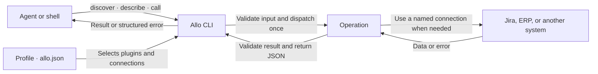
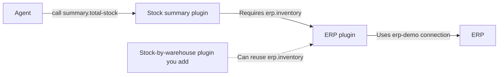
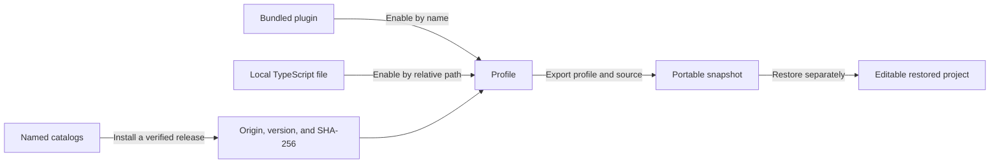

# Allo

Allo gives agents a single local command for working with systems such as Jira and ERP. A project chooses its capabilities in an `allo.json` **profile**. Plugins expose **operations** agents can call and **services** other plugins can reuse.

## From a request to a result

An agent can discover what a project supports, inspect the input and result schemas for an operation, and call it with JSON. For a familiar operation, it can call it directly.



Allo gets its operation list from the plugins that load for the selected profile. If a plugin fails to load, discovery reports the failure and independent operations can still run.

| Concept | The question it answers | Example |
| --- | --- | --- |
| Profile | What can Allo do in this project? | Enable plugins and configure their connections in `allo.json`. |
| Operation | What can an agent call? | `summary.total-stock` accepts a SKU and returns a quantity. |
| Service | What can a plugin reuse? | `erp.inventory` provides inventory lookup to other plugins. |
| Connection | Which external destination should this plugin use? | `erp-demo` names the fixture ERP connection. |

## How plugins compose

The ERP starter enables two plugins. The ERP plugin provides the inventory service and knows how to fetch warehouse stock. The summary plugin depends on that service and exposes an operation that adds up the quantities. A new stock-by-warehouse plugin can use the same service with its own input and result schemas.



Browse the [starter profile](examples/erp/starter/allo.json), the [ERP service](examples/erp/starter/plugins/erp.ts), and the [summary operation](examples/erp/starter/plugins/stock-summary.ts) to see the same composition in code.

## Where plugins come from

A profile can mix **bundled plugins** shipped with Allo, **local plugins** loaded from editable files, and **catalog plugins** installed from versioned releases. A catalog answers what's available to install. The selected profile determines what's enabled for this invocation.



Local source edits take effect on the next invocation. Catalog updates follow the pinned origin. A snapshot captures the sources needed to restore a composition, including bundled plugin revisions and unpublished edits. Credentials are supplied on the machine that runs it, and the restored operations can query current external data.

## Run the starter

Use Node.js 22.18 or newer and npm. From this repository, install dependencies with `npm ci` and run `node src/cli.js --help`. To make `allo` available on your PATH from a checkout, run `npm link`.

Start the fixture ERP in one terminal with `node examples/erp/fixture.mjs`. In another terminal, change to `examples/erp/starter` and try these commands.

```sh
allo discover
allo describe service erp.inventory
allo describe operation summary.total-stock
```

Set `ALLO_FIXTURE_TOKEN` to `demo-token` in the calling shell. The fixture also accepts a different value when you set the same variable in both shells.

```sh
echo '{"sku":"A42"}' | allo call summary.total-stock
```

The operation returns a total quantity of 18. You can also put the JSON input in a file and pass `--input-file <path>`. Every command returns one JSON document with `ok` and either `result` or `error`. Errors exit nonzero. Plugin diagnostics go to stderr.

## Add a lookup

Ask a coding agent to add a stock-by-warehouse lookup to the starter project. It can discover `erp.inventory` and copy the registration pattern in [stock-summary.ts](examples/erp/starter/plugins/stock-summary.ts).

1. Write a TypeScript plugin that injects `allo` and `erp.inventory`. Call `inventory.lookup(sku)` and select the requested warehouse.
2. Register the operation with its qualified name, JSON Schema input and result, and required connection. Add the entry point path to the profile’s `plugins` array.
3. Run `allo discover` and `allo describe operation <name>` to check the registration. Then call the operation with SKU `A42` and warehouse `Bilbao`.

Allo looks for the nearest `allo.json` in the working directory or its ancestors. Use `--profile <path>` to select a specific profile. Plugin paths are relative to that file. Use a path string or an object with `path` and `config`. Allo resolves declared service dependencies even when a consumer is listed first.

## Save and restore

```sh
allo snapshot export monday.allo-snapshot.json
allo snapshot restore monday.allo-snapshot.json --to monday
allo discover --profile monday/allo.json
```

Restore creates a new editable project directory. It recovers plugin entry points, statically imported local runtime files, the profile, and the project’s npm dependency lock when present. List extra files such as assets and dynamic imports in the profile’s `snapshotFiles` array. Keep npm dependencies in a standalone `package.json` with a version 3 `package-lock.json`. Restore uses the recorded Allo release and installs registry dependencies by their pinned versions and integrity hashes with lifecycle scripts disabled.

Edit the quantity in `examples/erp/stock.json`, then call the restored lookup with `--profile monday/allo.json`. The fixture reads the file on every request, so the restored lookup returns the new quantity.

Connections store a destination URL and an optional `credentialEnv` variable name. Keep credentials in the environment and profile configuration limited to shareable settings. Local connection definitions can live in `~/.allo/connections.json` or a file selected via `--connections <path>`. Use the same connection object format as the profile. If a local name matches a profile name with a different destination, restore reports the conflict and operations requiring that connection wait for an explicit mapping such as `--map-connection erp-demo=erp-test`.

Run `npm test` to verify the authoring and recovery flow against the fixture ERP.

## Connect to Jira Cloud

The shipped [Jira plugin](src/plugins/jira.ts) is enabled by adding `{ "plugin": "jira", "config": { "connection": "jira" } }` to a profile’s `plugins` array. Copy [the example profile](examples/jira/allo.example.json) to `examples/jira/allo.json` and set `connections.jira.destination` to your Atlassian Cloud site URL. For a scoped Atlassian API token, use `https://api.atlassian.com/ex/jira/<cloudId>/` as the destination. Allo snapshots include a copy of the bundled Jira source pinned by its SHA-256 digest. [Atlassian REST API authentication and URI formats](https://developer.atlassian.com/cloud/jira/platform/rest/v3/intro/#authentication-and-authorization)

On Windows, log in once per named connection. Allo verifies the account with Jira before saving the token in Windows Credential Manager. This PowerShell example reads the token with a masked prompt. [Atlassian API token setup](https://developer.atlassian.com/cloud/jira/platform/basic-auth-for-rest-apis/)

```powershell
Set-Location examples/jira
$email = Read-Host 'Atlassian account email'
(Get-Credential -UserName $email -Message 'Enter your Jira API token').GetNetworkCredential().Password | allo.cmd login jira --email $email
allo.cmd status jira
allo.cmd discover
'{"key":"PROJ-123"}' | allo.cmd call jira.get-issue
'{"jql":"assignee = currentUser() ORDER BY updated DESC","maxResults":10}' | allo.cmd call jira.search-issues
```

For a temporary session or CI, supply both `ALLO_JIRA_EMAIL` and `ALLO_JIRA_TOKEN` in the environment. A connection can name a different token variable with `credentialEnv`. A complete pair takes precedence over the saved login. `allo logout jira` removes the saved entry for the selected connection and destination.

Use `allo describe operation <name>` to inspect schemas. Allo exposes the following Jira operations.

- Read issues with `jira.get-issue` or `jira.search-issues`. Search one page at a time with `nextPageToken`, or use `jira.search-all` for up to 1,000 issues per call. Its count is the number retrieved in this call, and its `complete` flag indicates whether it reached the final page.
- Inspect form requirements with `jira.list-issue-types`, `jira.create-fields`, and `jira.edit-fields`. Then use `jira.create-issue` or `jira.update-issue`. Pass custom values in `fields` keyed by Jira field ID.
- Use `jira.find-assignees` and `jira.assign-issue` to assign by account ID. Use `jira.list-comments` and `jira.add-comment` for discussion.
- Use `jira.list-transitions` to inspect valid transitions, their target status, and any required fields. Pass the selected transition ID and fields to `jira.transition-issue`.

Descriptions and comments accept plain text or Atlassian Document Format. If a write returns `outcome_unknown`, check the issue in Jira before retrying.

## Install plugins from catalogs

Each profile can register several named catalogs. A catalog source is a local JSON file or an HTTPS URL. Register private sources by pointing to a local checkout or passing `--credential-env <variable>` for an HTTPS bearer token. The profile stores the variable name. Allo forwards the token only to the catalog origin.

To try the bundled sample, run these commands from `examples/jira` with your `allo.json` in place.

```sh
allo catalog add sample ../catalog/catalog.json
allo plugin search jira
allo plugin add sample/jira-summary
allo plugin list
allo plugin update sample/jira-summary
allo plugin remove sample/jira-summary
allo catalog remove sample
```

The example uses bundled Jira as a dependency. On an empty profile, enable it with `allo plugin add bundled/jira`. For a local plugin, use `allo plugin add ./plugins/example.ts`. Local paths are relative to the selected profile. Choose a qualified catalog name whenever a short name matches more than one catalog. Use `--release <version>` to install a particular compatible release.

The [sample catalog](examples/catalog/catalog.json) can seed a separate catalog repository. Each release declares its SemVer version, the compatible Allo version range, the source URL or path, the SHA-256 of the exact source bytes, and any required plugin IDs. A release is a standalone TypeScript file that can use Node built-ins and services provided by enabled plugins. Publish a new version and digest when the source changes.

Install verifies the digest and pins the release in the profile. Update follows the original catalog. Remove disables the plugin in the selected profile and reports any declared dependents. Cached releases stay on disk so a failed profile change cannot remove an enabled revision. Snapshots carry the pinned source and can run without contacting the catalog.
